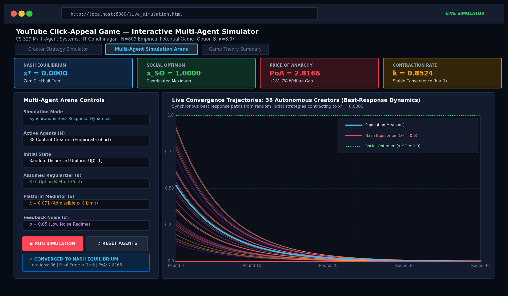

# Click Appeal as a Potential Game: Modeling Creator Incentives, Attention Congestion, and Social Welfare in YouTube Recommendation

CS 329: Foundations of AI: Multi-Agent Systems  
Indian Institute of Technology Gandhinagar  

---

## Project Overview

Content creators on video platforms compete for a shared resource: viewer attention. When creators escalate the attention-attracting characteristics of their titles and thumbnails (click-appeal), individual choices can generate congestion externalities that affect the collective viewership of all competing creators.

This project investigates this strategic competition through the framework of **continuous exact potential games**. Rather than assuming synthetic payoff functions, the game's payoff parameters are empirically estimated from real-world YouTube data (809 videos across 38 technology channels).

The repository covers four integrated stages:
1. **Multimodal Feature Extraction:** Deriving a continuous click-appeal score x_i in [0, 1] combining 4 title NLP features and 4 thumbnail computer vision features.
2. **Empirical Payoff Estimation:** Estimating a quadratic revenue function relating video log-views to own click-appeal, peer average appeal, and interaction effects.
3. **Game-Theoretic Formulation:** Proving the potential game property, deriving the closed-form symmetric Nash equilibrium (x_Nash) and Social Optimum (x_SO), and calculating the Price of Anarchy (PoA).
4. **Simulations & Learning Dynamics:** Evaluating iterated best-response dynamics, platform recommendation mechanisms (epsilon-incentive-compatible mediator), and trial-and-error payoff-based learning under feedback noise.

---

## Key Results

### 1. Price of Anarchy and Coordination Inefficiency
- **Empirical Parameters:** beta_1 = -2.019 (negative own linear return), beta_2_eff = -12.197 (individual payoff concavity), beta_3 = -5.542 (attention congestion), beta_5 = +20.794 (strategic complementarity).
- **Equilibrium vs. Optimum:** 
  - Unique symmetric Nash equilibrium: x_Nash = 0.0 (zero click-appeal).
  - Social optimum: x_SO = 1.0 (maximum coordinated appeal).
  - **Price of Anarchy:** PoA = 2.8161.
- **Mechanism:** Because individual marginal returns at zero are negative (beta_1 < 0), no creator has an incentive to unilaterally adopt high-appeal packaging. However, because network complementarity is large (beta_5 > 0), universal coordination yields a 182% view expansion. Decentralized competition leaves creators trapped at zero appeal.

### 2. Platform Mediator Intervention (RQ1)
- The platform recommends an interpolated score x_lambda = (1 - lambda) * x_Nash + lambda * x_SO for lambda in [0, 1].
- **Finding:** Marginal platform nudges (lambda <= 0.07) result in **negative welfare recovery** (R(lambda) < 0). Because social welfare is convex (B = beta_2_eff + beta_5 = +8.60 > 0) with a negative initial externality (E = beta_3 = -5.54), moving away from x_Nash initially reduces total welfare before rising above baseline at lambda > 0.145. Effective intervention requires sufficiently strong coordination incentives.

### 3. Payoff-Based Trial-and-Error Learning (RQ2)
- Creators observe only realized noisy payoffs $`y_i(t) = \pi_i(x_i(t), x_{\text{peer}}(t)) + \varepsilon_i(t)`$ and adjust intensity via a step-decay trial-and-error rule (Marden et al., 2009).
- **Low Noise (sigma <= 0.05):** 100% of simulation runs converge to the Nash equilibrium within approximately 5 rounds.
- **Empirical Volatility (sigma = 1.14):** At the empirical residual variance observed in YouTube data, noisy feedback triggers spurious direction reversals. Convergence drops to 0% and strategy dispersion remains high (D_T in [0.45, 0.96]). Creators cannot reliably learn the equilibrium from raw view counts alone.

## Quickstart & Verification

> **No setup required to explore results:** View the hosted [Interactive Simulation Dashboard](https://bhavya9shah.github.io/Multiagent-Systems/dashboard.html) directly in your browser.


---

## Interactive Browser Simulator



An interactive visual simulator is included in `simulations/live_simulation.html`. It runs directly in any modern web browser without requiring a server, Python installation, or external dependencies.

> **Live Demo:** [**Launch the Interactive Browser Simulator**](https://bhavya9shah.github.io/Multiagent-Systems/simulations/live_simulation.html) — runs directly in your browser with zero setup required.

- **Creator Strategy Simulator:** Test how an individual creator's view count and audience retention respond to varying own appeal and competitor competition.
- **Multi-Agent Simulation Arena:** Run real-time simulations of 38 autonomous creators interacting under best-response dynamics, low-noise learning, empirical-noise learning, or mediator intervention.
- **Analytical Summary:** Key theoretical derivations and empirical parameters organized for quick reference.

To run locally:
```bash
# Option A: Direct browser open
# Simply open simulations/live_simulation.html in Chrome, Firefox, Safari, or Edge.

# Option B: Local HTTP server
python -m http.server 8080 --directory simulations
# Navigate to http://localhost:8080/live_simulation.html
```

---

## Repository Structure

```
Multiagent-Systems/
├── README.md                               # Project overview and summary
├── requirements.txt                        # Core Python dependencies
│
├── Data_Collection/                        # Data acquisition scripts and raw channel metadata
│   ├── scripts/
│   └── data/
│
├── Click appeal score/                     # Feature extraction and composite score computation
│   ├── features/                           # Extracted title and thumbnail feature CSVs
│   ├── scores/                             # Normalized video-level click-appeal scores (N=809)
│   ├── scripts/                            # NLP, MediaPipe face detection, and image analysis
│   └── README.md
│
├── payoff_calculation/                     # Econometric estimation of creator payoff functions
│   ├── results/                            # OLS and cluster-robust regression results
│   │   └── game_theory_coefficients.json   # Exported parameters for game-theoretic analysis
│   ├── scripts/                            # Centered model training, cross-validation, and bootstrap
│   └── README.md
│
├── game_theoretic_formulation/             # Potential game analysis and closed-form equilibria
│   ├── scripts/
│   │   ├── game_theory_solver.py           # PotentialGame class and closed-form solver
│   │   ├── run_game_theoretic_analysis.py  # Analysis runner and sensitivity grid
│   │   └── generate_game_theory_plots.py   # Publication plots 01 to 04
│   ├── plots/                              # Best-response, potential landscape, and PoA heatmaps
│   ├── tests/test_game_theory.py           # 14 unit tests for game-theoretic conditions
│   └── README.md
│
└── simulations/                            # Multi-agent dynamics, mediation, and learning
    ├── scripts/
    │   ├── sim_dynamics.py                 # Iterated best-response simulation
    │   ├── sim_mediator.py                 # Platform mediator lambda sweeps and eps-IC analysis
    │   ├── sim_learning.py                 # Payoff-based trial-and-error learning implementation
    │   ├── sim_sweeps.py                   # Parameter sensitivity sweeps (sigma, eta, beta_5, n, kappa)
    │   ├── sim_bootstrap.py                # 10,000-draw parametric bootstrap uncertainty
    │   └── sim_regime_compare.py           # Master experiment runner
    ├── plots/                              # Figures 01 to 11
    ├── results/                            # Trajectory logs, sweep data, and summary tables
    ├── tests/test_simulations.py           # 31 unit tests for simulation dynamics
    ├── dashboard.html                      # Overview dashboard of figures and tables
    ├── live_simulation.html                # Standalone client-side interactive simulator
    └── README.md
```

---

## Quickstart & Verification

### 1. Setup
```bash
git clone https://github.com/Bhavya9Shah/Multiagent-Systems.git
cd Multiagent-Systems
pip install -r requirements.txt
```

### 2. Running Unit Tests
All theoretical conditions, equilibrium properties, and simulation dynamics are verified with automated unit tests:

```bash
# Part 3: Game-theoretic formulation (14 tests)
python -m unittest game_theoretic_formulation/tests/test_game_theory.py

# Part 4: Multi-agent simulations and learning (31 tests)
python -m unittest simulations/tests/test_simulations.py
```

### 3. Reproducing Simulation Experiments
To re-run the full simulation pipeline and regenerate all figures:
```bash
python simulations/scripts/sim_regime_compare.py --with-learning --with-bootstrap
```

---

## References

1. Aumann, R. J. (1987). Correlated equilibrium as an expression of Bayesian rationality. *Econometrica*, 55(1), 1–18.
2. Marden, J. R., Young, H. P., Arslan, G., & Shamma, J. S. (2009). Payoff-based dynamics for multiplayer weakly acyclic games. *SIAM Journal on Control and Optimization*, 48(1), 373–396.
3. Monderer, D., & Shapley, L. S. (1996). Potential games. *Games and Economic Behavior*, 14(1), 124–143.
4. Nash, J. (1950). Equilibrium points in n-person games. *Proceedings of the National Academy of Sciences*, 36(1), 48–49.
5. Roughgarden, T. (2005). *Selfish Routing and the Price of Anarchy*. MIT Press.
